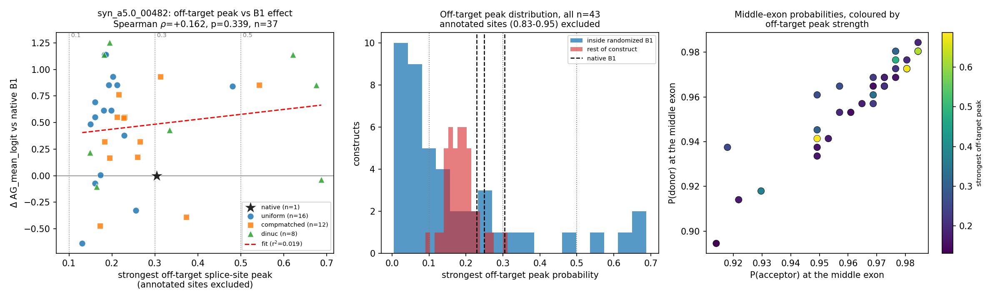

# B1 pilot — cryptic splice site check

Run 2026-10-20. **44 AlphaGenome calls** (43 full-track re-scores + 1 `score_core`
call for the parity assertion), single stream, 0 failures, 6 s wall clock.
All outputs in `outputs/upstream_exon/cryptic_check/`. Nothing existing was
modified; nothing committed.

**[MEASURED]** = computed from this run's data · **[INTERPRETATION]** = my reading
· **[OPEN]** = still unresolved.

---

## Verdict

**[INTERPRETATION] The pilot's conclusion survives. The B1 effect is not a
cryptic-splice-site artifact.**

Randomized B1 blocks do sometimes create a novel predicted splice site — the
strongest reaches P = 0.69, in 4 of 43 constructs it exceeds 0.5 — but the
strength of that novel site is uncorrelated with how much the construct moves
the middle exon's score (Spearman ρ = +0.162, p = 0.339, n = 37; r² = 0.019).
The middle exon's own acceptor and donor peaks never drift, not once in 43
constructs, and a cryptic site never outranks them.

The single most direct piece of evidence is a near-matched comparison the data
handed over for free: **four variants produce *exactly* the same effect
(Δ = +1.141) while their strongest off-target peak ranges from 0.18 to 0.62.**
And the variant with the largest effect of all (dinuc_03, Δ = +1.254) has an
off-target peak of 0.194 — *lower than the native PNAS B1's own* 0.305.

---

## 1. What was measured, and the two preconditions

### 1.1 The full-track scorer reproduces `score_core` exactly

`upstream_exon/cryptic_lib.py:score_core_fulltrack` makes the same call
(`OutputType.SPLICE_SITES`, `Organism.HOMO_SAPIENS`, `ontology_terms
["CL:0002518"]`), through the same `create_model` / `clean_seq` / `center_pad` /
`get_positive_strand_tracks`, and returns the whole positive-strand donor and
acceptor tracks cropped to the unpadded core, alongside `score_core`'s scalars.

**[MEASURED]** Parity on `syn_a5.0_00482|native_PNAS|r1`, all six shared scalars
**exactly equal** (`==`, not `isclose`) — full log in `parity_check.txt`:

| | `score_core` | full-track |
|---|---|---|
| `AG_acceptor_probability` | 0.94921875 | 0.94921875 |
| `AG_donor_probability` | 0.9453125 | 0.9453125 |
| `AG_mean_logit` | 2.88899624121022 | 2.88899624121022 |

**[MEASURED]** Beyond the parity construct, all **43/43** re-scored constructs
reproduce the pilot's stored `AG_mean_logit` with `max |diff| = 0.00e+00`. The
full-track path is the same measurement, and this run is a bit-identical
re-observation of the pilot — a fourth replication of its within-session
determinism.

### 1.2 The four annotated splice sites are where the block layout says

Every construct was rebuilt with `b1_lib.build_construct` and SHA-256-verified
against `b1_pilot_manifest.csv` before any call, as `run_b1_pilot.py` does.
Positions derived from the `assemble8` block offsets, and confirmed by the
tracks themselves:

| site | kind | position | probability across 43 constructs (min / median / max) |
|---|---|---|---|
| upstream exon 5'SS | donor | 115 | 0.397 / 0.727 / 0.957 |
| **middle exon 3'SS** | acceptor | **243** | 0.512 / 0.969 / 0.984 |
| **middle exon 5'SS** | donor | **318** | 0.656 / 0.965 / 0.984 |
| downstream exon 3'SS | acceptor | 1168 | 0.441 / 0.875 / 0.945 |

Positions 243 and 318 are exactly the two `score_core` reads. The upstream exon
has no acceptor and the downstream exon no donor inside the construct, so four
is the complete annotated set.

### 1.3 Constructs re-scored

43 constructs, replicate 1, fixed-length only:

- **`syn_a5.0_00482`** (the pilot's recommended exon): native + all 36
  fixed-length B1 variants = **37** — this is the correlation sample
- `syn_a0.5_00475` (plateau) and `syn_a1.0_00359` (rising control): native +
  the most extreme up and down variant each = **6** — a cross-exon spot check

---

## 2. Result (c): the middle exon's peaks never drift

**[MEASURED]** Searching ±5 nt around each expected position, in all 43
constructs:

- **acceptor drift: 0/43.** The argmax is at 243 every time; the only drift
  value observed is 0.
- **donor drift: 0/43.** The argmax is at 318 every time.
- The local maximum exceeds the value at the read position by at most
  **0.00e+00** — the read position *is* the local maximum, not a shoulder of it.
- The middle exon's acceptor is the **global** acceptor argmax of the entire
  1,309-nt construct in **43/43**.
- The middle exon's donor is the global donor argmax in **39/43**. In all four
  exceptions the winner is position **115 — the upstream exon's own annotated
  donor** — not a cryptic site, and it wins by ≤ 0.028 (e.g. 0.945 vs 0.938).

**[INTERPRETATION]** Open question 3 from the pilot ("acceptor-peak drift") is
**resolved, negatively**. `score_core` reading two fixed indices is not losing
the signal to a shifted peak; the two indices it reads are the correct peaks in
every construct tested. This also means the pilot's measured Δ values are not
contaminated by a peak sliding out from under the read position.

---

## 3. Results (a) and (b): off-target peaks exist, and are mostly weaker than native's

Annotated sites excluded with a ±3 nt half-width (AlphaGenome peaks are a few nt
wide, so excluding only the exact base would let a real peak's shoulder pose as a
cryptic site). The choice does not matter here: with **only the four exact
positions** excluded the maximum is identical, 0.6875.

**[MEASURED]** Strongest off-target peak, over all 43 constructs:

| | min | median | max |
|---|---|---|---|
| anywhere in the construct | 0.0903 | 0.2021 | **0.6875** |
| inside the randomized B1 | — | 0.0986 | **0.6875** |
| rest of the construct | — | 0.1826 | 0.3125 |

**[MEASURED] The native PNAS B1 is itself not clean.** Scored in three exon
contexts, its off-target maximum is **0.3047, 0.2490, 0.2295** — in every case a
donor peak inside B1 itself (position 99 in the primary exon). The native
upstream exon body is real β-globin exon 1 sequence and carries a moderate
cryptic donor signal of its own. **Only 8 of the 37 primary-exon variants exceed
the native's own level.** Most randomization makes the construct *less*
cryptic-prone, not more.

**[MEASURED]** Constructs with any off-target position above a threshold:

| threshold | constructs | peak inside B1 | max positions in one construct |
|---|---|---|---|
| > 0.1 | 42 / 43 | 20 | 5 |
| > 0.3 | 9 / 43 | 8 | 1 |
| > 0.5 | **4 / 43** | 4 | 1 |

**[INTERPRETATION]** 0.1 is not a useful threshold — almost every construct,
including all three natives, clears it. 0.3 is roughly the native's own level, so
it marks "no worse than the starting material". **0.5 is the tier that is
genuinely novel**, and four constructs reach it. All four peaks are donors inside
B1, at B1 positions 80, 40, 52 and 82.

**[MEASURED]** The strongest cryptic site in the whole experiment:
`syn_a5.0_00482|dinuc_06` at **0.6875** — while its own middle-exon sites sit at
0.949 / 0.941, essentially native.

---

## 4. The correlation test: no relationship



**[MEASURED]** Primary exon `syn_a5.0_00482`, n = 37, `delta_vs_native` spanning
−0.638 to +1.254:

| predictor | vs | Spearman ρ | p | Pearson r | p |
|---|---|---|---|---|---|
| **strongest off-target peak anywhere** | **Δ** | **+0.162** | **0.339** | +0.139 | 0.412 |
| strongest off-target peak anywhere | \|Δ\| | +0.072 | 0.673 | +0.099 | 0.561 |
| strongest peak inside B1 | Δ | +0.049 | 0.772 | +0.041 | 0.809 |
| strongest donor peak inside B1 | Δ | +0.140 | 0.408 | +0.097 | 0.570 |
| strongest acceptor peak inside B1 | Δ | −0.253 | 0.132 | −0.203 | 0.229 |

Linear fit of Δ on the strongest off-target peak: **r² = 0.019**, slope +0.465
logit per unit peak probability, p = 0.412.

**[MEASURED]** Grouping rather than correlating gives the same answer:

- variants with off-target > 0.5 (n = 4): median Δ +0.855; the rest (n = 33):
  median Δ +0.545 — Mann–Whitney **p = 0.281**
- variants with off-target > 0.3 (n = 9): median Δ +0.841; the rest (n = 28):
  median Δ +0.549 — Mann–Whitney **p = 0.683**

### 4.1 The three individual cases that settle it

**[MEASURED]**

| case | off-target peak | Δ vs native |
|---|---|---|
| strongest cryptic site in the experiment (`dinuc_06`) | **0.688** | **−0.037** |
| largest effect in the experiment (`dinuc_03`) | **0.194** | **+1.254** |
| native PNAS B1 (the reference) | 0.305 | 0.000 (by definition) |

And the near-matched set — **four variants with identical Δ = +1.141**
(AlphaGenome's 1/256 quantization makes them exactly equal), at off-target peaks
of **0.182, 0.186, 0.194 and 0.621**:

```
uniform_12   offtarget 0.183   delta +1.141
uniform_13   offtarget 0.186   delta +1.141
dinuc_02     offtarget 0.182   delta +1.141
dinuc_07     offtarget 0.621   delta +1.141   <- 3.4x the cryptic signal, same effect
```

**[INTERPRETATION]** If a cryptic site were driving the effect, `dinuc_07` could
not land on precisely the same value as three variants with a third of its
off-target signal, and `dinuc_06` — carrying the strongest cryptic donor measured
— could not produce an effect of zero.

### 4.2 An independent line from the pilot's own arm comparison

**[MEASURED]** Off-target peak strength differs systematically by randomization
arm:

| arm | n | median off-target | max |
|---|---|---|---|
| uniform | 16 | 0.184 | 0.480 |
| compmatched | 12 | 0.229 | 0.543 |
| **dinuc** | 8 | **0.264** | **0.688** |

**[INTERPRETATION]** The dinucleotide-shuffle arm generates the strongest cryptic
sites, which is what you would expect — it preserves the GT and AG dinucleotide
counts of a real exon. Yet the pilot found the three arms statistically
indistinguishable in their effect distributions (Kruskal–Wallis H = 0.931,
p = 0.628). An arm with measurably more cryptic sites produces no measurably
different effect. That is a second, independent argument against the confound,
and it comes from data already collected.

---

## 5. Cross-exon spot check

**[MEASURED]** Native plus the most extreme up and down variant for two further
exons. No drift anywhere, and the extremes are not the high-off-target
constructs:

| exon | b1_id | Δ | off-target max | peak in B1 | acceptor drift | donor drift |
|---|---|---|---|---|---|---|
| syn_a0.5_00475 | uniform_03 | −0.674 | 0.115 | 0.051 | 0 | 0 |
| syn_a0.5_00475 | native_PNAS | 0.000 | 0.249 | 0.249 | 0 | 0 |
| syn_a0.5_00475 | uniform_13 | +1.111 | 0.169 | 0.065 | 0 | 0 |
| syn_a1.0_00359 | uniform_15 | **−1.771** | **0.090** | 0.011 | 0 | 0 |
| syn_a1.0_00359 | native_PNAS | 0.000 | 0.230 | 0.230 | 0 | 0 |
| syn_a1.0_00359 | compmatched_02 | +0.119 | 0.252 | 0.093 | 0 | 0 |

**[INTERPRETATION]** The largest single effect in this table, −1.771, comes from
the construct with the **lowest** off-target peak of all 43 (0.090). In both
exons the native — the zero point — has a *higher* cryptic signal than either
extreme variant.

---

## 6. What this does and does not establish

**[MEASURED] Facts.**
1. The full-track scorer reproduces `score_core` exactly; this run reproduces the
   pilot exactly, 43/43.
2. The middle exon's acceptor and donor peaks never drift (0/43, both).
3. A cryptic site never outranks the middle exon's sites; in 4/43 the middle
   donor is edged out only by the upstream exon's *annotated* donor.
4. Novel sites do appear: 4/43 constructs exceed P = 0.5, maximum 0.6875, all
   donors inside B1.
5. Spearman(strongest off-target peak, Δ) = +0.162, p = 0.339, n = 37, r² = 0.019.
6. The native PNAS B1 carries an off-target peak of 0.23–0.30; only 8 of 37
   variants exceed it.

**[INTERPRETATION]** The pilot's headline — that upstream-exon body sequence
moves AlphaGenome's prediction for a fixed middle exon by up to ~1.3 logit units
— is not produced by cryptic splice sites. Pilot open question 1 is resolved
negatively and open question 3 is resolved negatively. The scale-up and the CNN
training are not being built on this particular artifact.

**[OPEN] Limits of this check, stated plainly.**
- **Statistical power.** n = 37 gives 81 % power to detect ρ = 0.45 and 70 % at
  ρ = 0.40. A *weak* contribution from cryptic sites (|ρ| ≲ 0.4) is not excluded
  — only a dominant one. The r² of 0.019 bounds the linearly-explainable share of
  the variance at ~2 %, but that is a point estimate on 37 points.
- **This is a predicted-probability analysis, not a competition analysis.** The
  SPLICE_SITES track says a position looks like a splice site; it does not model
  which site actually wins. A 0.69 donor inside B1 is a real prediction. What this
  check shows is that its presence does not move the middle exon's score — not
  that it would be inert in a cell.
- **One exon carries the correlation.** The 37-point test is `syn_a5.0_00482`
  only; the other two exons contribute 6 constructs and are consistent but cannot
  test correlation on their own.
- **Only fixed-length, replicate-1 constructs.** The 59-nt FAS B1, which produced
  the largest effect anywhere in the pilot (+1.750), was **not** re-scored here —
  it changes the construct length and so shifts every downstream coordinate.
  Its cryptic-site status is untested.
- The pilot's other open questions (no natural-exon arm, the fixed x-axis, the
  unsampled extremes) are untouched by this check.

**[INTERPRETATION] One recommendation for the scale-up.** Since the full-track
call costs exactly the same as the two-position call, the scale-up should retrieve
full tracks and store these off-target summaries per construct from the start.
Then this check is a column in the results rather than a separate run, and any
genuinely extreme construct can be flagged and excluded rather than argued about
after the fact.

---

## 7. Files written

```
upstream_exon/
  cryptic_lib.py                 full-track scorer, parity assertion, known-site
                                 geometry, off-target / drift measurement
  check_cryptic_sites.py         subset selection, SHA-256 verify, run loop
  analyze_cryptic_check.py       tables, correlations, plot

outputs/upstream_exon/cryptic_check/
  parity_check.txt                     score_core parity log (PASS, exact)
  cryptic_measurements.csv             43 rows, all per-construct measurements
  cryptic_measurements_annotated.csv   joined to delta_vs_native
  cryptic_correlations.csv             the 8 correlation tests
  cryptic_summary.txt                  the full printed analysis
  cryptic_tracks.npz                   86 raw core-cropped tracks (43 x donor/acceptor)
  cryptic_offtarget_vs_effect.png      scatter + distribution + probability plane
  call_count.txt
```

No existing file was modified or overwritten.
