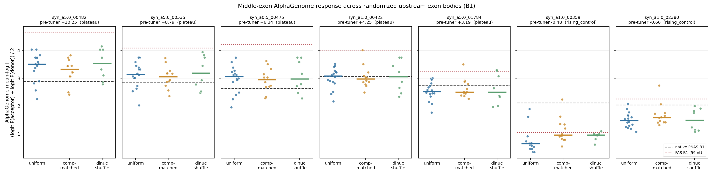
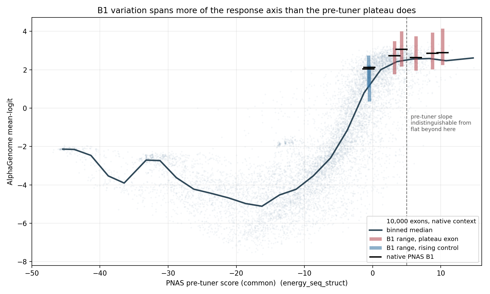
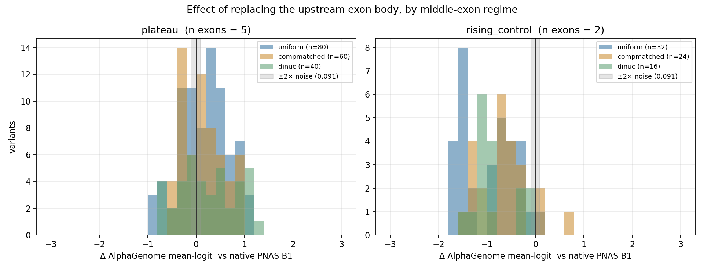
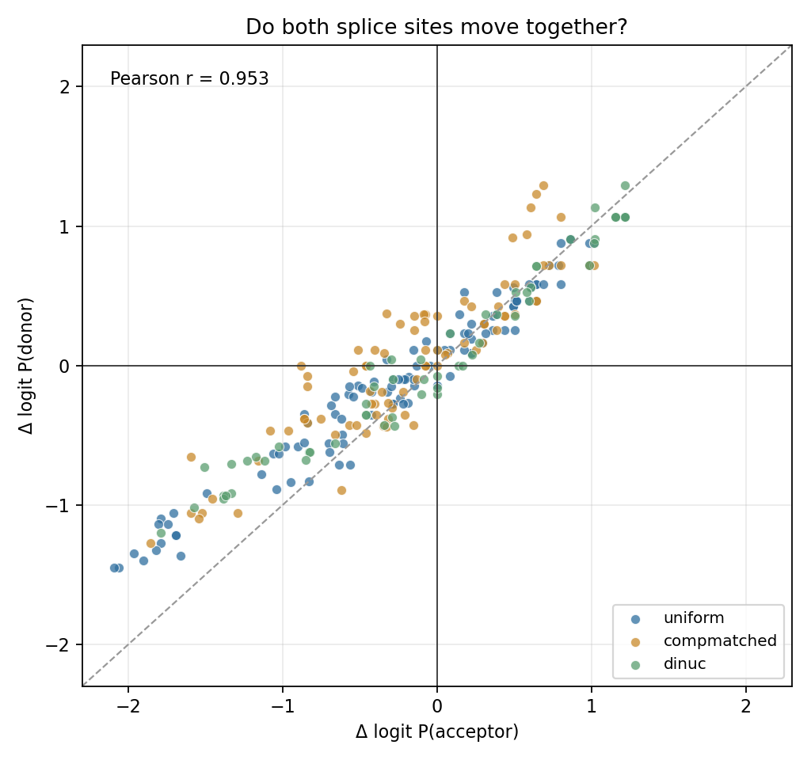
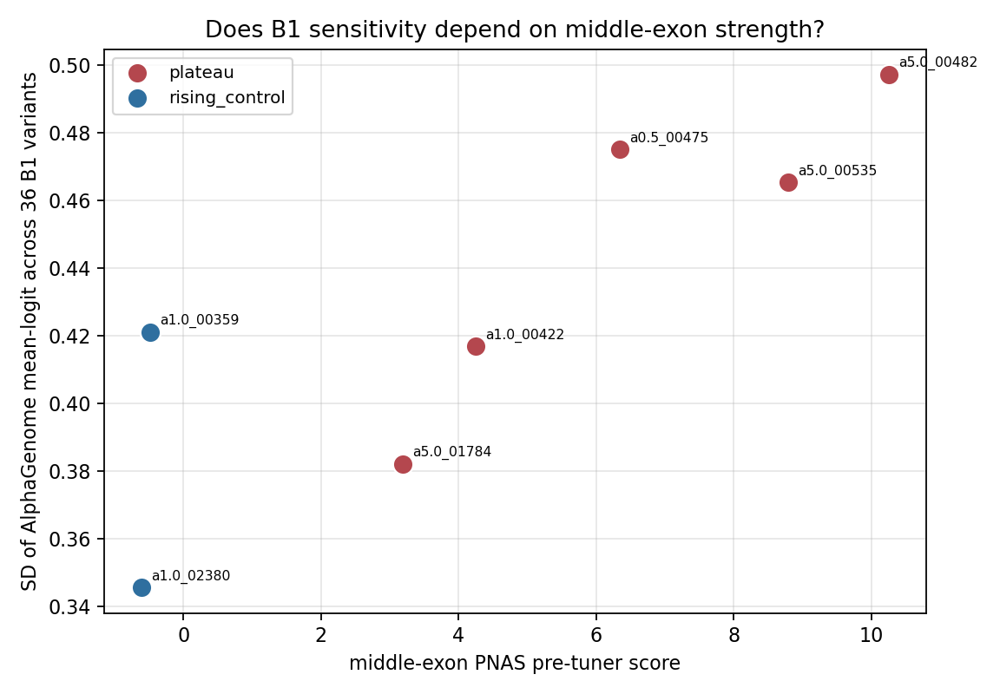

# Upstream-exon (B1) pilot — results

Run 2026-10-20. 273/273 AlphaGenome calls succeeded, 0 failures, 44 s wall clock.
All outputs in `outputs/upstream_exon/`. Nothing existing was modified; nothing committed.

**[MEASURED]** = computed from this pilot's data · **[INTERPRETATION]** = my reading · **[OPEN]** = unresolved.

---

## 1. Headline

**[MEASURED] Upstream-exon body sequence substantially changes AlphaGenome's prediction for a fixed middle exon, including for middle exons on the pre-tuner plateau — and the effect is sequence-specific, composition-independent, and highly consistent across middle exons.**

The numbers that matter:

| Quantity | Value |
|---|---|
| Calls succeeded / attempted | **273 / 273** (0 failures) |
| Within-run reproducibility (7 duplicate native constructs) | **exactly 0.000** — bit-identical |
| Cross-session reproducibility vs the 2026-10-07 endpoint run | max **0.0456** logit units (= 1 probability quantum) |
| Response SD across 36 B1 variants, per exon | **0.346 – 0.497** |
| Response range (p95 − p5), per exon | **0.955 – 1.552** |
| Signal-to-noise (SD / noise floor) | **≈ 7.6× – 10.9×** |
| Cross-exon consistency of per-variant effect (mean pairwise Spearman) | **0.945** |
| Effect explained by B1 GC content | **none** (\|r\| ≤ 0.16, p > 0.3) |

**[INTERPRETATION] This justifies training the proposed PNAS-derived CNN.** There is a large, reproducible, sequence-determined signal that no simple composition summary explains — which is precisely the regime where a motif-level convolutional model is the right tool.

---

## 2. Execution and validation

### 2.1 What ran

| Stage | Result |
|---|---|
| Manifest dry-run | **24/24 structural checks passed** (`build_b1_manifest.py --validate-only`) |
| Construct rebuild + SHA-256 verify | 273/273 matched the manifest before any call |
| API smoke test | 1 call, reproduced the stored endpoint value to within 1 quantum |
| Full pilot | 272 further calls, 0 failures, 0.16 s/call |

**[MEASURED] Validation checks that passed** (full list in `outputs/upstream_exon/b1_pilot_validation_report.txt`):

- the native-B1 construct is **byte-identical** to the 8-block `PPPPPPPP`, the 6-block `PPPPPP`, *and* the independent `run_alphagenome_pnas_fulltrack_sanity.build_construct` reference — three independent reconstructions agreeing at 1,309 nt
- every fixed-length construct is exactly **1,309 nt**; the FAS-reference constructs are **1,255 nt** (113 − 59 shorter), flagged and excluded from the fixed-length analysis
- B2–B8 re-extracted from each assembled core by offset are byte-identical to `pnas_blocks8()`, for all 273
- all four splice-site dinucleotides (`GT`/`AG` at B2, B4, B5, B7) survive in every construct
- dinucleotide shuffles preserve base counts **and** dinucleotide counts exactly, and all 8 differ from native
- regenerating the panel from the master seed reproduces every sequence (determinism)
- 266 distinct constructs + 7 deliberate native replicates = 273; no accidental duplicates

### 2.2 Reproducibility — a result in its own right

**[MEASURED]** The 7 duplicated native constructs returned **bit-identical** values within this session: `abs_diff = 0.000` for all seven, on both acceptor and donor. AlphaGenome is deterministic within a session.

Across sessions it is not quite. Comparing each exon's native value against the same construct scored on 2026-10-07 (free, because the native-B1 construct *is* the endpoint `PPPPPPPP` construct):

| exon | this run | 2026-10-07 | \|Δ\| |
|---|---|---|---|
| syn_a0.5_00475 | 2.63247 | 2.63247 | 0.00000 |
| syn_a1.0_00422 | 3.06543 | 3.06543 | 0.00000 |
| syn_a5.0_01784 | 2.73571 | 2.73571 | 0.00000 |
| syn_a1.0_02380 | 2.03963 | 2.02153 | 0.01810 |
| syn_a1.0_00359 | 2.11751 | 2.09777 | 0.01974 |
| syn_a5.0_00482 | 2.88900 | 2.93107 | 0.04207 |
| syn_a5.0_00535 | 2.86016 | 2.90571 | 0.04555 |

**[MEASURED]** 3 of 7 reproduce exactly; the other 4 differ by at most one 1/256 probability quantum. **Noise floor adopted: 0.0456 logit units.** Every effect below is reported against it.

---

## 3. Results

### 3.1 Response distributions (deliverable 1)



**[MEASURED]** Every one of the 7 middle exons shows B1-dependent variation far exceeding the noise floor. Per exon, across the 36 fixed-length variants:

| rank | exon | class | pre-tuner | native | SD | IQR | p95−p5 | min | max |
|---|---|---|---|---|---|---|---|---|---|
| 1 | **syn_a5.0_00482** | plateau | +10.25 | 2.889 | **0.497** | 0.680 | **1.552** | 2.251 | **4.143** |
| 2 | syn_a0.5_00475 | plateau | +6.34 | 2.632 | 0.475 | 0.591 | 1.476 | 1.958 | 3.744 |
| 3 | syn_a5.0_00535 | plateau | +8.79 | 2.860 | 0.465 | 0.674 | 1.319 | 2.028 | 3.936 |
| 4 | syn_a1.0_00359 | rising | −0.48 | 2.118 | 0.421 | 0.357 | 1.252 | 0.347 | 2.236 |
| 5 | syn_a1.0_00422 | plateau | +4.25 | 3.065 | 0.417 | 0.427 | 1.334 | 2.173 | 4.003 |
| 6 | syn_a5.0_01784 | plateau | +3.19 | 2.736 | 0.382 | 0.462 | 1.261 | 1.772 | 3.497 |
| 7 | syn_a1.0_02380 | rising | −0.60 | 2.040 | 0.346 | 0.435 | 0.955 | 1.081 | 2.740 |

**[MEASURED]** 86–100 % of variants (depending on exon) move the response by more than 2× the noise floor.

### 3.2 B1 raises *and* lowers the response — and which one depends on the middle exon (deliverable 2)

This is the pilot's most striking result, and it directly answers the question you flagged.

**[MEASURED]** Counting variants that move the response beyond the noise floor:

| exon | pre-tuner | **up** | **down** | flat | median Δ | best variant |
|---|---|---|---|---|---|---|
| syn_a1.0_02380 | −0.60 | 2 | **32** | 2 | **−0.497** | +2.740 |
| syn_a1.0_00359 | −0.48 | 1 | **35** | 0 | **−1.295** | +2.236 |
| syn_a5.0_01784 | +3.19 | 11 | 24 | 1 | −0.229 | +3.497 |
| syn_a1.0_00422 | +4.25 | 15 | 17 | 4 | −0.039 | +4.003 |
| syn_a0.5_00475 | +6.34 | **28** | 8 | 0 | **+0.376** | +3.744 |
| syn_a5.0_00535 | +8.79 | **24** | 10 | 2 | **+0.281** | +3.936 |
| syn_a5.0_00482 | +10.25 | **28** | 6 | 2 | **+0.553** | **+4.143** |

**[MEASURED] The direction of the B1 effect is monotonically related to middle-exon pre-tuner score:**

- Spearman(pre-tuner, fraction of variants moving up) **ρ = 0.929, p = 0.0025**
- Pearson(pre-tuner, median Δ) **r = 0.896, p = 0.0063**
- linear fit `median Δ = +0.134 × pre-tuner − 0.729`, crossing zero at **pre-tuner ≈ +5.4**

**[INTERPRETATION]** For weak middle exons the native PNAS upstream exon is close to the best available — almost any replacement makes things worse. For strong middle exons the native upstream exon is *not* optimal, and most replacements improve recognition. The crossover sits at pre-tuner ≈ +5.4, inside the attenuated region.

This reproduces and refines the sign flip I found in the pre-existing 8-block data (B1 swap: +1.1 on plateau exons, −0.9 on rising ones) — now with 36 variants per exon instead of one, and with a measured dose–response in the middle-exon strength.

### 3.3 Escape from the plateau



**[MEASURED]** The plateau level for the 10,000-exon library is a median of **+2.48**, and the best any exon achieves in the native context is **+3.44**. In this pilot, B1 substitution alone pushes four of the five plateau exons past that:

- syn_a5.0_00482: native +2.889 → **+4.143**
- syn_a1.0_00422: native +3.065 → **+4.003**
- syn_a5.0_00535: native +2.860 → **+3.936**
- syn_a0.5_00475: native +2.632 → **+3.744**

**[MEASURED]** The FAS B1 (59 nt, reported separately) goes further still, reaching **+4.639** on syn_a5.0_00482 — Δ = +1.750.

**[INTERPRETATION] The pre-tuner plateau is not a ceiling on AlphaGenome's response.** It is where the native PNAS context happens to place strong exons. A single 113-nt block substitution moves exons well above the entire 10,000-exon native-context distribution. **[OPEN]** As flagged in the design doc, this remains a statement about the predicted score, not a demonstrated mechanism — the pre-tuner x-coordinate is fixed by construction, so "escaping the plateau" is movement on one axis of a 2-D plot.

### 3.4 The three randomization methods are indistinguishable (deliverable 3)



**[MEASURED]** Pooled over the five plateau exons:

| arm | n | median Δ | SD | frac up |
|---|---|---|---|---|
| uniform | 80 | +0.204 | 0.514 | 0.613 |
| composition-matched | 60 | +0.092 | 0.436 | 0.600 |
| dinucleotide shuffle | 40 | +0.188 | 0.609 | 0.600 |

Kruskal–Wallis across arms: **H = 0.931, p = 0.628** — no detectable difference.

**[MEASURED]** B1 GC content explains essentially nothing within any exon: |r| ≤ 0.163 with p > 0.34 for all five plateau exons (one rising control reaches r = +0.359, p = 0.032, which does not survive correction for 7 tests).

**[INTERPRETATION] This is the key control result, and it cuts two ways.** Favourably: the effect is *not* a composition artifact — matching the native base frequencies, or preserving its dinucleotide composition exactly, changes nothing about the distribution of outcomes, and GC has no predictive power. So the out-of-distribution worry I raised in the design document is not what is driving the signal. Unfavourably: all three arms destroy the native sequence's higher-order arrangement, so what the pilot establishes is that *the specific 113-nt sequence matters*, within a space of sequences that are all non-native. **[OPEN]** Whether the effect extends across *naturally occurring* upstream exon bodies is untested — the natural-exon arm was deferred, and it remains the most informative missing control.

### 3.5 Sequence-specific and consistent across exons

**[MEASURED]** The same B1 variant has nearly the same effect on every middle exon: mean pairwise Spearman of per-variant Δ across the five plateau exons = **0.945** (range 0.883–0.984).

Best and worst variants, averaged over the five plateau exons:

```
worst  uniform_03 −0.80   compmatched_04 −0.46   dinuc_01 −0.44
best   dinuc_07 +0.91     dinuc_03 +0.90        compmatched_02 +0.90
```

Note the best and worst both contain members of all three arms — further confirmation that the arm matters less than the particular sequence.

**[INTERPRETATION] This is the single most important result for the modelling plan.** A per-variant effect that is ~0.95-consistent across five different middle exons, with no composition explanation, is exactly a learnable sequence→scalar function. It also means a model trained on one middle exon should transfer in rank to others.

### 3.6 Both splice sites move together



**[MEASURED]** Δ logit P(acceptor) and Δ logit P(donor) correlate at **r = 0.953**. B1 moves the middle exon's recognition as a unit rather than acting on one site.

**[INTERPRETATION]** Consistent with an exon-definition-like effect rather than a local change to one splice-site motif — which is plausible given B1 is ~900 nt from the middle exon. It also means `AG_mean_logit` loses little information relative to the two separate probabilities, supporting its use as the single modelling target.



---

## 4. Recommendation (deliverables 4 and 5)

### 4.1 Use `syn_a5.0_00482` as the fixed middle exon

```
sequence_id   syn_a5.0_00482        alpha 5.0     pre-tuner +10.252
syn70         ATCACGCCTCTTACTGAGACGCCGAATGCCACCTGTCTACGCCCGTCCAGAAGCCCGACGTCGCCAACTT
exon (76 nt)  GTTATCACGCCTCTTACTGAGACGCCGAATGCCACCTGTCTACGCCCGTCCAGAAGCCCGACGTCGCCAACTTCAG
native AG_mean_logit  +2.889      B1 range  2.251 .. 4.143
```

Against the §2.4 criteria from the design document:

| Criterion | Result |
|---|---|
| 1. Largest spread across B1 variants | **rank 1** — SD 0.497, p95−p5 1.552, both highest |
| 2. Spread not outlier-driven | **IQR 0.680**, highest of the seven, ~15× the noise floor |
| 3. FAS B1 inside the explored range | partially — FAS reaches +4.639 vs the random max +4.143, so it sits just outside |
| 4. Composition neutrality | acceptable — GC 0.600, longest homopolymer 3, max base fraction 0.40 |
| 5. Replication arm | **use `syn_a0.5_00475`** (rank 2, SD 0.475, and a different Dirichlet regime, α = 0.5) |

**[INTERPRETATION]** `syn_a5.0_00482` wins on every spread measure, sits furthest into the statistically-flat region (pre-tuner +10.25), and has the clearest upward escape (28 of 36 variants up, max +4.143). Criterion 3 is a mild caveat rather than a problem: the random panel covers 81 % of the FAS effect, so the space being explored is the right one, but the extremes are not yet saturated by random sampling.

`syn_a0.5_00475` as the replication arm is a deliberate choice over the nominally-better-ranked `syn_a5.0_00535` — it comes from a different α regime, so a result holding across both is less likely to be an artifact of near-uniform composition.

### 4.2 Does this justify training the CNN? **Yes.**

Measured against the design document's go/no-go gate ("proceed if at least two plateau candidates show SD ≥ 0.3 and p95−p5 ≥ 0.8, with the composition-matched arm showing comparable spread"):

- **all five** plateau candidates clear SD ≥ 0.3 (0.382–0.497) and p95−p5 ≥ 0.8 (1.261–1.552)
- the composition-matched arm is statistically indistinguishable from uniform (p = 0.628)
- signal-to-noise is ~11× in SD, ~34× in range

**[INTERPRETATION]** The gate is cleared with margin. Beyond the gate, two results specifically favour the planned architecture: the effect is **not** explained by composition (so a bag-of-bases model will fail, and a motif-level convolution is the appropriate next step), and per-variant effects are **0.945-consistent across middle exons** (so the target is a stable function of B1, not an exon-specific quirk).

**[INTERPRETATION] One honest caveat about expected model performance.** The pilot shows sequence identity matters but gives no evidence yet about *what* feature of the sequence matters. If the mechanism turns out to be distributed and non-additive, the PNAS architecture's purely additive position-wise sum may underfit. That is still worth doing — as noted in the architecture review, an informative underfit is a result — but the k-mer ridge and mean-predictor baselines should be run alongside from the start, not afterwards.

---

## 5. Open questions

1. **[OPEN] Cryptic splice sites remain unchecked.** This was my top-flagged confound and the pilot does not resolve it: `score_core` reads only the two target positions, and I used it unmodified as instructed. A random 113-mer can contain a plausible `AG`/`GT`, and a novel competing site would change the middle exon's prediction through an uninteresting route. The strong cross-exon consistency (0.945) argues against it being the *dominant* mechanism — a cryptic site would act on the construct, which is shared, so it would actually produce consistency too. **This needs resolving before the scale-up**, and it needs full-track retrieval, which means either a small addition to the new package or ~40 re-scored constructs.
2. **[OPEN] No natural-exon arm.** All three arms are non-native sequences. The claim "upstream exon sequence modulates middle-exon recognition" is established within that space; whether it holds across real upstream exons is untested, and that is the biologically meaningful version of the question.
3. **[OPEN] Acceptor-peak drift.** Also unresolved for the same reason as (1) — worth folding into the same full-track pass.
4. **[OPEN] The x-axis question stands.** `PNAS_common` cannot move across B1 variants by construction, so plots of response against it are informative about regime but cannot show "escape" in a mechanistic sense.
5. **[OPEN] Sampling the extremes.** The FAS B1 beats all 36 random variants on four of five plateau exons, so random sampling is not reaching the top of the achievable range. The scale-up should consider a directed component, or simply far more samples.
6. **[MEASURED, resolved]** AlphaGenome determinism — answered: exact within session, ≤ 1 quantum across sessions.

---

## 6. Files written

```
upstream_exon/
  b1_lib.py                        generators, assembly, per-construct validation
  build_b1_manifest.py             manifest + 24-point dry-run validation
  run_b1_pilot.py                  SHA-verified scoring via run_scoring (unmodified)
  analyze_b1_pilot.py              tables + plots

outputs/upstream_exon/
  b1_pilot_manifest.csv            273 rows, one per call
  b1_variant_panel.csv             38 B1 variants with sequences and digests
  b1_pilot_exons.csv               the 7 middle exons
  b1_pilot_validation_report.txt
  b1_pilot_ag_results.csv          273 scored rows
  b1_pilot_results_annotated.csv   results + native levels + Δ
  b1_pilot_reproducibility.csv     within-run and cross-session
  b1_pilot_arm_summary.csv         per exon × arm
  b1_pilot_candidate_ranking.csv   the ranking in §3.1
  plots/  b1_distributions_by_exon.png
          b1_delta_distributions.png
          b1_range_on_saturation_curve.png
          b1_effect_vs_exon_strength.png
          b1_acceptor_vs_donor.png
```

The B1 panel is shared across all seven middle exons, which costs no extra calls — each (exon, B1) pair is a distinct construct either way — and is what made the cross-exon consistency measurement in §3.5 possible.
